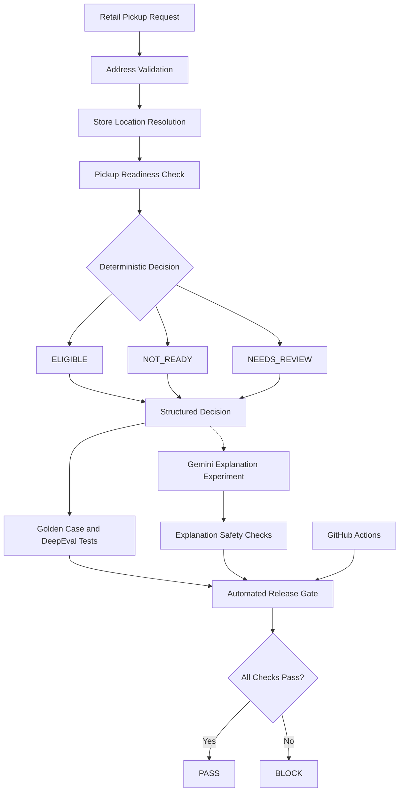

# Eval-First Retail Fulfillment Agent

### Building reliable AI workflows through evaluation-driven engineering

An independent, synthetic retail fulfillment simulation demonstrating how deterministic business rules, AI-generated explanations, regression testing, and automated release gates can work together to reduce incorrect pickup promises.

**Tech stack:** Python 3.10 | LangGraph | Google Gemini | DeepEval | LangSmith | GitHub Actions

> This is an independent portfolio project. It is not affiliated with Apple or any retailer. All scenarios and business policies are synthetic; store records are illustrative fixtures.

## 1. The Business Problem

Global retail pickup workflows must handle differences in address formats, store-location data, and order readiness.

A system can create customer-facing errors when it:

- Rejects an otherwise valid address because a postal code is missing.
- Associates an order with an incorrect or unknown pickup location.
- Promises pickup before readiness has been confirmed.
- Generates customer-facing language that introduces unsupported commitments.

The engineering challenge is not simply producing an AI response. It is ensuring that the final decision and explanation remain consistent with verified business facts.

## 2. Solution Overview

This project separates deterministic decision-making from natural-language explanation generation.



LangGraph orchestrates the validation and decision nodes. Gemini is used in a separate experiment to generate customer-facing explanations.

The language model does not determine pickup eligibility.

## 3. Decision Model

The system returns one of three decisions:

| Decision     | Meaning                                                               |
| ------------ | --------------------------------------------------------------------- |
| ELIGIBLE     | Address and location are valid, and pickup readiness is confirmed     |
| NOT_READY    | Address and location are valid, but pickup readiness is not confirmed |
| NEEDS_REVIEW | Address validation or store-location resolution failed                |

A pickup promise is permitted only for ELIGIBLE decisions.

The simulated postal-code policy is:

| Country              | Synthetic rule       |
| -------------------- | -------------------- |
| United Arab Emirates | Postal code optional |
| Turkey               | Postal code optional |
| United States        | Postal code required |

These rules are project-specific test fixtures, not authoritative postal requirements.

## 4. Evaluation-First Engineering

The project uses multiple evaluation layers.

### Layer 1 — Deterministic Golden Dataset

Thirty synthetic cases cover three countries and six store records.

Test categories include:

- Successful pickup eligibility
- Orders not ready for pickup
- Missing postal codes
- Store and address mismatches
- Unknown stores

**Observed result: 30/30 correct decisions.**

### Layer 2 — Mutation Testing

A deliberately defective policy changed the UAE and Turkey postal-code requirements from optional to required.

| Run             | Correct decisions |
| --------------- | ----------------: |
| Original policy |             30/30 |
| Mutated policy  |             18/30 |

The mutation introduced 12 detectable regressions.

The experiment demonstrates that the test suite can identify this specific policy defect.

### Layer 3 — DeepEval Decision Testing

DeepEval custom deterministic metrics verify decision correctness against expected results.

**Observed result: 30/30 passed.**

These checks are not an LLM-as-judge evaluation.

### Layer 4 — Gemini Explanation Safety

Three saved Gemini explanations were evaluated against explicit rules for unsupported claims and unauthorized pickup promises.

The initial evaluation identified a NOT_READY explanation containing unsupported language about processing status and future notifications.

| Evaluation                   | Passed | Outcome |
| ---------------------------- | -----: | ------- |
| Original Gemini explanations |    2/3 | BLOCK   |
| Injected unsafe explanation  |    2/3 | BLOCK   |
| Remediated explanations      |    3/3 | PASS    |

Example:

**Original response — Blocked**

> Your order is still processing and is not yet ready for pickup. We will notify you as soon as it is ready for collection.

**Revised response — Passed**

> Pickup is not available yet.

The revised explanation avoids unsupported commitments.

The current explanation checks use narrowly defined pattern-matching rules. Passing them does not establish that an explanation is free from every possible hallucination or safety issue.

## 5. Automated Release Governance

GitHub Actions executes the evaluation release gate on pushes and pull requests.

The release runner checks:

1. Golden decision and pickup-promise safety tests
2. DeepEval decision correctness
3. Remediated Gemini explanation checks using saved fixtures

Any failed check causes the release-gate process to exit unsuccessfully.

**Verified:** The initial GitHub Actions workflow completed successfully.

The CI workflow uses saved Gemini responses and does not call Gemini to generate new responses.

A successful CI run is an evaluation-gate result, not evidence of a production deployment.

## 6. Reproduce the Results

Requires Python 3.10 or later.

Install dependencies:

```bash
python -m pip install -r requirements.txt
```

Run the baseline:

```bash
python -m evals.run_evals
```

Run the automated release gate:

```bash
python release_gate.py
```

Run the mutation experiment separately:

```bash
python mutation_test.py
```

Generate the historical experiment scorecard:

```bash
python build_scorecard.py
```

The scorecard currently contains previously verified experiment results rather than automatically collecting fresh measurements.

The automated release-gate report is written to:

```text
results/release_gate_report.json
```

## 7. Observability

LangSmith tracing was used locally to inspect LangGraph execution and individual processing nodes.

Tracing is optional and requires separate configuration.

API credentials must be supplied through environment variables and must never be committed to the repository.

## 8. Key Engineering Trade-offs

**Deterministic eligibility vs. LLM decisions**

Eligibility is calculated using explicit rules so that language generation cannot independently authorize pickup.

**Fail-closed behavior**

Unknown locations, address mismatches, and missing required fields result in NEEDS_REVIEW rather than unsupported pickup promises.

**Regression detection**

Mutation testing demonstrates that a policy change can be detected before release.

**Evaluation before remediation**

The original Gemini response was evaluated and blocked before a revised explanation was generated and retested.

**Cost-aware CI**

GitHub Actions uses saved model outputs, allowing repeatable checks without requiring paid inference on every code change.

## 9. Limitations and Future Work

This is a synthetic engineering demonstration, not a production retail platform.

Current limitations:

- Thirty golden cases are not representative of all international address formats.
- The explanation evaluation covers only three saved responses.
- Regex-based checks cannot reliably detect every unsupported or contradictory statement.
- The workflow does not perform live Gemini inference in CI.
- No real retailer APIs, inventory systems, or customer data are integrated.

Planned enhancements:

- Held-out adversarial evaluation datasets
- DeepEval GEval / LLM-as-judge experiments
- Stronger semantic grounding and contradiction checks
- Prompt and model version comparisons
- Evaluation trends and release scorecards
- Pull-request branch protection and required checks

## Portfolio Evidence — Evaluation and Release Governance

### Verified Results

| Experiment | Result | Engineering significance |
|---|---|---|
| Golden dataset | 30/30 passed | Baseline decision correctness |
| Policy mutation | 12 regressions detected | Detects incorrect country-policy changes |
| DeepEval custom metric | 30/30 passed | Independent decision test implementation |
| Original Gemini explanations | 2/3 passed | Unsupported claims identified |
| Injected unsafe explanation | 2/3 passed | Unauthorized pickup promise detected |
| Remediated explanations | 3/3 passed | Targeted remediation verified |
| GitHub Actions | Successful | Automated CI release gate executed |

### Failure-to-Remediation Example

**Case:** BASE-002 — Pickup not ready

**Original explanation:**

> Your order is still processing and is not yet ready for pickup. We will notify you as soon as it is ready for collection.

**Evaluation result:** BLOCK

The response introduced unsupported processing and notification claims.

**Revised explanation:**

> Pickup is not available yet.

**Evaluation result:** PASS

The revised response passed the configured safety rules.

### CI/CD Evidence

[View GitHub Actions evaluation runs](https://github.com/gopakumarcfnet/eval-first-retail-fulfillment-agent/actions)

The release gate executes deterministic tests and evaluates saved Gemini explanations. A failing check produces a nonzero exit code and fails the workflow.

### Evaluation Scope

These results come from synthetic scenarios and a small saved-response experiment. They demonstrate the evaluation process, not production reliability or comprehensive LLM safety.

## 10. Why This Project Matters

This project demonstrates an evaluation-driven approach to AI program delivery:

**Define the risk → Establish measurable acceptance criteria → Build the workflow → Inject failures → Evaluate outcomes → Remediate defects → Automate release checks.**

The goal is not to demonstrate a production-ready retail agent. It is to show how engineering teams can make AI-assisted workflows more testable, observable, and governable.
